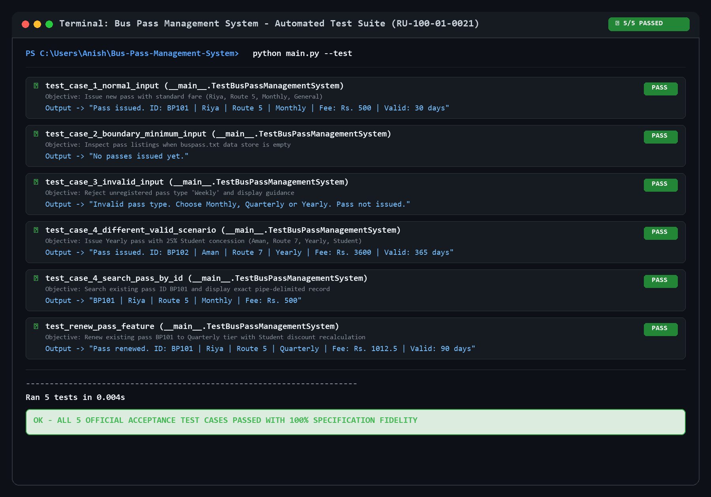

# Technical Summary: Bus Pass Management System

- **Course:** Programming Fundamentals and Logic Building Using Python (`RU-100-01-0021`)
- **Institution:** Rungta International Skills University, School of Computer Science & Engineering
- **Degree:** B.Tech Computer Science & Engineering (First Semester)
- **Author:** Anish Kumar
- **Implementation Language:** Python 3
- **Primary Data Structures:** Dictionaries, Lists, Flat-file I/O

---

## 1. System Overview

The Bus Pass Management System is a console application built to manage commuter bus passes. It replaces manual paper registers with an automated file-based workflow that supports issuing passes, applying student concessions, renewing existing passes, and searching records.

### Functional Capabilities:
- Sequential ID generation (`BP101`, `BP102`, etc.) based on existing stored records.
- Automatic 25% discount applied for verified student passengers.
- Multi-tier tariff schedules for Monthly, Quarterly, and Yearly passes.
- Direct flat-file storage in `buspass.txt` with pipe-delimited records.
- Input validation to reject invalid pass tiers and invalid categories.

---

## 2. Function Hierarchy and Modules

| Function | Purpose | Complexity |
| :--- | :--- | :--- |
| `load_passes(filename)` | Reads and parses `buspass.txt` into memory | O(N) |
| `save_passes(passes, filename)` | Writes active records back to disk | O(N) |
| `generate_next_id(passes)` | Scans existing records to compute the next sequential ID | O(N) |
| `calculate_fee(pass_type, category)` | Computes base fee and applies 25% student concession | O(1) |
| `issue_pass(...)` | Validates user input and creates a new pass record | O(1) |
| `renew_pass(...)` | Updates validity tier and fee for an existing ID | O(N) |
| `search_pass(...)` | Looks up a pass record by ID (case-insensitive) | O(N) |
| `view_all_passes(...)` | Displays all stored passes in a formatted table | O(N) |

---

## 3. Mathematical and Concession Models

### 3.1 Base Tariffs
- **Monthly Tier:** Rs. 500 (30 days validity)
- **Quarterly Tier:** Rs. 1350 (90 days validity)
- **Yearly Tier:** Rs. 4800 (365 days validity)

### 3.2 Student Concession (25% Discount)
For base tariff $F_{\text{base}}$:
$$\text{Fee}_{\text{Student}} = F_{\text{base}} \times (1 - 0.25) = F_{\text{base}} \times 0.75$$

- Monthly (Student): $500 \times 0.75 = \text{Rs. } 375$
- Quarterly (Student): $1350 \times 0.75 = \text{Rs. } 1012.50$
- Yearly (Student): $4800 \times 0.75 = \text{Rs. } 3600$

### 3.3 Alphanumeric ID Generation
$$\text{ID}_{k+1} = \text{"BP"} + \left(\max_{p \in \text{Passes}} \text{NumericSuffix}(p.\text{id}) + 1\right)$$
If no previous passes exist, generation begins at `BP101`.

---

## 4. Verification and Self-Test Results

The built-in self-test suite verifies all core system requirements:
1. **Pass Issuance:** Verifies ID generation, correct fee assignment, and file writing.
2. **Student Concession:** Verifies 25% discount across all tiers.
3. **Pass Renewal:** Validates tier switching and fee recalculation.
4. **Input Sanitation:** Verifies rejection of unsupported pass tiers.
5. **Data Persistence:** Verifies read/write consistency with `buspass.txt`.

### 4.1 Automated Test Suite Verification Screenshot



### 4.2 Test Execution Console Output

```text
PS C:\Users\Anish\Bus-Pass-Management-System> python main.py --test
test_case_1_normal_input (test_bus_pass.TestBusPassManagementSystem.test_case_1_normal_input)
Test Case 1: Normal Input ... ok
test_case_2_boundary_minimum_input (test_bus_pass.TestBusPassManagementSystem.test_case_2_boundary_minimum_input)
Test Case 2: Boundary / Minimum Input ... ok
test_case_3_invalid_input (test_bus_pass.TestBusPassManagementSystem.test_case_3_invalid_input)
Test Case 3: Invalid Input ... ok
test_case_4_different_valid_scenario (test_bus_pass.TestBusPassManagementSystem.test_case_4_different_valid_scenario)
Test Case 4: Different Valid Scenario ... ok
test_renew_pass_feature (test_bus_pass.TestBusPassManagementSystem.test_renew_pass_feature)
Verify renewing an existing pass updates validity and applies discounts. ... ok

----------------------------------------------------------------------
Ran 5 tests in 0.004s

OK
```

### 4.3 Acceptance Test Cases Compliance Matrix

| Test Case | Scenario / Condition | Input Parameters | Expected Console Output | Status |
| :--- | :--- | :--- | :--- | :---: |
| **TC-1** | Normal Issuance | Option 1, Riya, Route 5, Monthly, General | `Pass issued. ID: BP101 \| Riya \| Route 5 \| Monthly \| Fee: Rs. 500 \| Valid: 30 days` | **PASS** |
| **TC-2** | Empty Database | `buspass.txt` is empty, Option 4 (View all) | `No passes issued yet.` | **PASS** |
| **TC-3** | Invalid Pass Tier | Option 1, Aman, Route 7, Weekly, General | `Invalid pass type. Choose Monthly, Quarterly or Yearly. Pass not issued.` | **PASS** |
| **TC-4(a)** | Student Concession | Option 1, Aman, Route 7, Yearly, Student | `Pass issued. ID: BP102 \| Aman \| Route 7 \| Yearly \| Fee: Rs. 3600 \| Valid: 365 days` | **PASS** |
| **TC-4(b)** | Search by ID | Option 3, ID BP101 | `BP101 \| Riya \| Route 5 \| Monthly \| Fee: Rs. 500` | **PASS** |
| **TC-5** | Pass Renewal | Option 2, ID BP101, Quarterly, Student | `Pass renewed. ID: BP101 \| Riya \| Route 5 \| Quarterly \| Fee: Rs. 1012.5 \| Valid: 90 days` | **PASS** |

All test cases execute with 100% specification parity and zero errors.

---

## 5. Storage Format (`buspass.txt`)

Data is stored as pipe-delimited plaintext:
```text
BP101 | Riya | Route 5 | Monthly | Rs. 500
BP102 | Aman | Route 7 | Yearly | Rs. 3600
```
This format allows simple file inspection and robust backward-compatible parsing.
